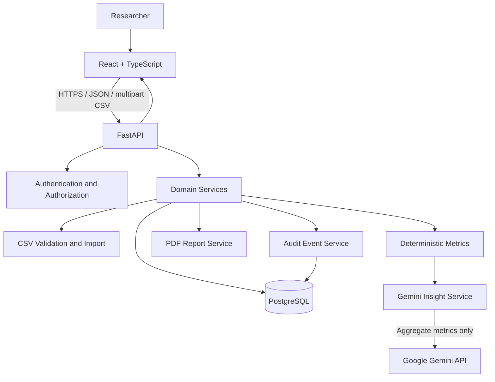

# System Architecture

## Overview
The application has four logical layers:
1. React frontend — pages, forms, charts, and report actions.
2. FastAPI REST API — authentication, validation, authorization, metrics, import, AI orchestration, PDF generation, and audit events.
3. PostgreSQL — persistent users, trials, participants, import metadata, and audit events.
4. Gemini service — optional external AI provider receiving minimized aggregate metrics only.

## Request flows
### CSV import
1. User selects a trial and CSV.
2. Frontend sends multipart upload to FastAPI.
3. Backend authenticates user and verifies trial access.
4. Backend checks file size, row limit, required headers, types, allowed statuses, and duplicates.
5. Preview response lists valid/invalid row counts and actionable errors.
6. On confirmation, backend imports within a transaction and records an audit event.
7. Metrics are computed from persisted records.

### Metrics
1. Frontend requests metrics for a trial.
2. API verifies authorization.
3. Service queries participant statuses and computes counts/rates in backend code.
4. API returns metric values, denominators, definitions, and data-quality flags.
5. Frontend displays cards and charts.

### AI insight
1. User explicitly requests analysis.
2. API authenticates and authorizes the request.
3. Backend computes metrics itself and constructs a constrained prompt with aggregate values only.
4. Gemini service calls the configured model with timeout and error handling.
5. Response is treated as untrusted text, validated/sanitized for display, and returned with model/time/disclaimer metadata.
6. An audit event records the request outcome without storing secrets or participant-level data.
7. If Gemini is unavailable, metrics and other features continue to work.

### PDF export
1. API verifies trial access.
2. Backend recomputes metrics and optionally includes a previously generated/validated AI insight.
3. PDF service creates a report with metric definitions, generation timestamp, and advisory disclaimer.
4. Export event is audited; file is returned as a download.

## Backend module responsibilities
- `api/`: routes and HTTP-level concerns.
- `schemas/`: Pydantic request/response models.
- `models/`: SQLAlchemy models.
- `services/`: business logic for CSV import, metrics, Gemini, PDF, and audit.
- `core/`: settings, security, logging, error handling.
- `db/`: session setup and database dependencies.
- `alembic/`: versioned schema migrations.

## Reliability and consistency
- CSV import is transactional; a failed import must not leave partial records unless a deliberate, documented partial-import design is approved.
- Unique constraint on `(trial_id, participant_id)`.
- Metric definitions live in one backend service and are reused by dashboard and PDF.
- External Gemini calls use timeouts and bounded input/output; no provider call inside database transactions.
- Do not store raw uploaded CSVs by default. If temporary files are required, clean them up and avoid persistent storage unless explicitly designed.
- Audit logs must not become a duplicate store of participant data.

## Security boundaries
- All trial-scoped endpoints enforce ownership/authorization in the backend.
- Secrets are environment-based.
- CORS allows only configured origins.
- Upload content is parsed as data, never executed.
- AI provider receives no direct identifiers or raw participant rows.
- Production deployment requires TLS, secret management, backups, monitoring, and a privacy/security review.
